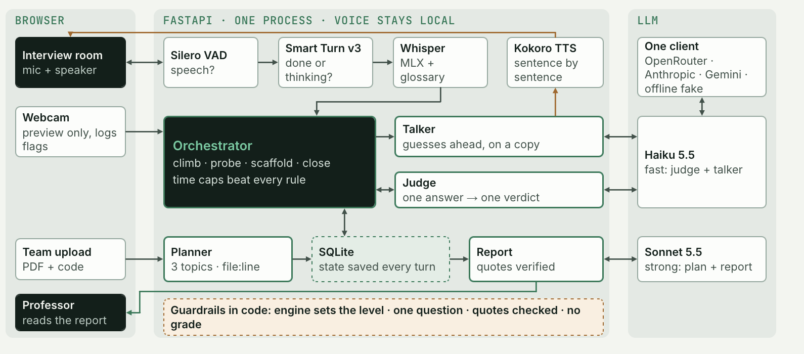
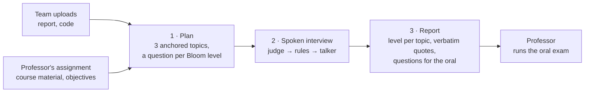
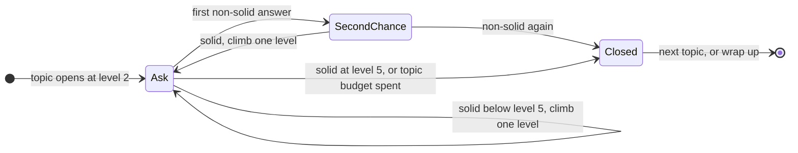

<p align="center"></p>

# Pythagoras

> 🏆 **1st place, Reply Student Clash 2026** — team **Pre Cooked** (Raul Agolli, Kevin Abate, Emanuele Scala, Domenico De Giorgio)

**AI oral assessment for project-based courses.** A team uploads its deliverable and has a ~10-minute **spoken
conversation** with Pythagoras about its own project. Pythagoras covers 3 topics, climbs Bloom's levels on each
(Understand → Apply → Analyze → Evaluate), and hands the professor a report to start the oral exam from.

**Pythagoras never assigns the grade.**

## Why

A polished report or a working codebase no longer shows that a team understands it: AI can write most of it. The
honest check is an oral exam, and oral exams do not scale. Pythagoras does the first ten minutes: it asks each team
about *its own* work, goes deeper while the answers hold, and tells the professor where they stopped holding, with
the team's own words as evidence. The professor decides.

## How it works



<sub>Smart Turn v3 is drawn in the voice path; in the live interview the answer now ends on **I'm done** and the
detector is kept but switched off (D24 in [`docs/DECISIONS.md`](docs/DECISIONS.md)).</sub>



1. **Plan** (background, strong model). The deliverable is read whole: PDFs as documents, code with line numbers.
   The plan has 3 topics, each anchored to a place in the work (`section 2.3`, `mlp.py:25`), with one question per
   Bloom level and the points a good answer must mention. Topic titles are neutral and questions never give away a
   flaw: it has to surface from the team's own answer.
2. **Interview** (live, fast models). For every answer a **judge** returns a verdict, **plain code** decides the
   next move, and a **talker** phrases it as one short spoken line.
3. **Report** (background, strong model). Summary, ownership, level reached per topic, quotes with their time,
   strengths, concerns, and 3 to 5 questions for the oral exam.

### The rules of the interview

The model judges single answers. What happens next is code (`pythagoras/engine.py`), so it is predictable and
tested:



The second chance is a **probe** after an incomplete answer (push on what is missing, without revealing it) or a
**hint** after a weak one or "I don't know" (point to the team's own deliverable, ask something simpler).
Pythagoras does not keep pushing: where a team stops is the result.

### What the code enforces

| The model is asked to… | The code makes sure |
|---|---|
| judge one answer | it never decides the next move |
| say one bridge sentence and one question | anything longer is cut down to that |
| keep the level reached | the engine's levels overwrite the report writer's |
| quote the team verbatim | every quote is searched in the transcript; what is not found is listed for the professor |
| stay within the time | when time is over the interview closes with a fixed line, without a model call |

The pitch video is in [`docs/Pythagoras_Pitch_final.mp4`](docs/Pythagoras_Pitch_final.mp4). More diagrams (one turn in detail, the voice path, what happens when something fails) are in
**[`docs/ARCHITECTURE.md`](docs/ARCHITECTURE.md)**.

## Run

```bash
python3.12 -m venv .venv && source .venv/bin/activate
pip install -e ".[voice,dev]"   # Apple Silicon: natural local voice (needs `brew install espeak-ng`)
# pip install -e ".[dev]"       # any other machine: the browser's voice is used instead
cp .env.example .env            # set ONE key: OPENROUTER_API_KEY, ANTHROPIC_API_KEY or GEMINI_API_KEY
python -m pythagoras check      # one real call per model
python -m pythagoras serve      # first start downloads the voice models (~2.5 GB) into .cache/
```

No key at hand? `PYTHAGORAS_FAKE_LLM=1 python -m pythagoras serve` runs the whole app with an offline stand-in.

| | |
|---|---|
| Team | <http://localhost:8000/>: team name, contact email and files, then the invite link (shown on screen when SMTP is not configured) |
| Professor | <http://localhost:8000/prof>: create assignments, see the deliverables, open the reports. Open by default; set `PYTHAGORAS_PROFESSOR_PASSWORD` to require a login |

Use Chrome or Edge. Guida di avvio in italiano: [`docs/GUIDA_AVVIO.md`](docs/GUIDA_AVVIO.md).

## Try the demo

The repository ships a synthetic case, [`cases/ffnn`](cases/ffnn): the assignment "A feed-forward network from
scratch", course notes, and a deliverable (report + `mlp.py`) with planted flaws. For example, the report says
Xavier initialisation and the code starts the first layer from zeros; the learning rate is chosen on the test set.

1. On the team page click **Use the neural network case**. The first click prepares the plan (~2 minutes), later clicks reuse it.
2. Talk. Press **I'm done** (or Space) when you have finished an answer.
3. Open the professor pages: the assignment has two finished example reports, **Team_1** and **Team_2**, with
   different levels reached. Interviews started from the demo button are not listed there; upload a deliverable
   through the form to see your own report.

`python scripts/smoke.py` runs a whole spoken interview against a running server with a synthetic student and
prints the time of every stage.

For the stage demo two **demo rules** are on by default (`PYTHAGORAS_DEMO_RULES`): "I don't know" always gets one
retry one Bloom level lower, and any real first answer on the initialisation topic climbs to level 3 whatever the
judge said. Set `PYTHAGORAS_DEMO_RULES=0` for the plain rules above.

## The conversation

With the `voice` extra all audio stays on the Mac: the page streams the microphone to the server, **Whisper**
(MLX) transcribes with the project's own terms as a glossary, **Kokoro** speaks. The answer ends when the team
presses **I'm done**: a pause to think never ends it.

While an answer is judged, Pythagoras says a short "Okay." at once, and the follow-up a solid answer leads to is
already being phrased; it is used if the verdict agrees and thrown away otherwise. The next question starts about
2–4 s after the answer ends (measured on an M1 Pro with Claude Haiku via OpenRouter and with Gemini Flash Lite).

The webcam is on during the interview with a **REC** badge and a timer. The badge is only visual: **nothing is
recorded or sent**. Leaving the tab or switching the camera off is noted for the professor as a review prompt, not
a verdict.

Without the extra (or with `PYTHAGORAS_VOICE=browser`) the same page uses the browser's speech APIs; Firefox falls
back to typing.

**Models.** On OpenRouter the defaults are Claude Sonnet 5.5 (plan, report) and Haiku 5.5 (judge, talker); a whole
interview including a new plan cost about $0.03. Gemini and the Anthropic API work with one key too.

## Layout

```
pythagoras/
  app.py          FastAPI: /api + static pages
  planner.py      Phase 1: deliverable (+ assignment, course material) -> plan + critical analysis
  engine.py       Phase 2: interview rules (Bloom climb, probe, hint, budgets, wrap-up), the parallel guess
  supervisor.py   judges each answer
  talker.py       phrases what Pythagoras says
  report.py       Phase 3: report for the professor, quotes checked against the transcript
  voice.py        local voice API: speech stream + microphone WebSocket
  audio.py        Whisper, Kokoro, voice activity
  llm.py          the only LLM client (OpenRouter, Claude or Gemini); fake.py = offline stand-in
  models.py       the data contracts: InterviewPlan, InterviewState, InterviewReport
  db.py           SQLite + files under data/
  mailer.py       invite email (SMTP) or data/outbox/
  static/         HTML/CSS/JS frontend, no build step
scripts/smoke.py  end-to-end spoken interview against a running server
tests/            offline: python -m pytest
cases/ffnn/       synthetic test case: assignment, course notes, deliverable, answer key, two example reports
docs/             ARCHITECTURE · DECISIONS (what and why) · API (pages and endpoints) · SPEC (the original idea)
```

## Tests

```bash
python -m pytest        # offline, no key: rules, report checks, planner inputs, API flow, microphone stream
```

## Limits

- It prepares the oral exam, it does not replace it. The verdict on a single answer can be wrong; that is why the
  report shows the quotes and the professor decides.
- The natural voice needs Apple Silicon and serves one interview at a time well.
- Not built: recording and click-to-play evidence, a multi-model check of the report, practice mode, professor
  accounts, deployment. See [`docs/DECISIONS.md`](docs/DECISIONS.md).
- Student data stays out of the repository (`data/`, real cases). Only the synthetic case is tracked.

## Team

Built by team **Pre Cooked** for Reply Student Clash 2026 (direction: Assessment): Raul Agolli, Kevin Abate, Emanuele Scala, Domenico De Giorgio. This repository is a fork of
[Keevin16/StudentClash-PreCooked](https://github.com/Keevin16/StudentClash-PreCooked).
