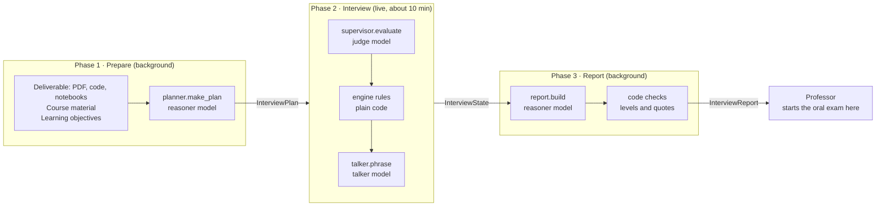
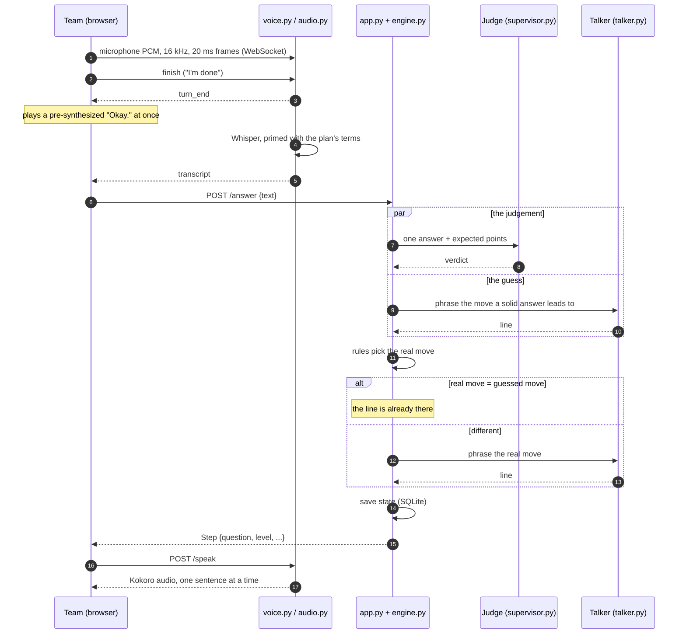
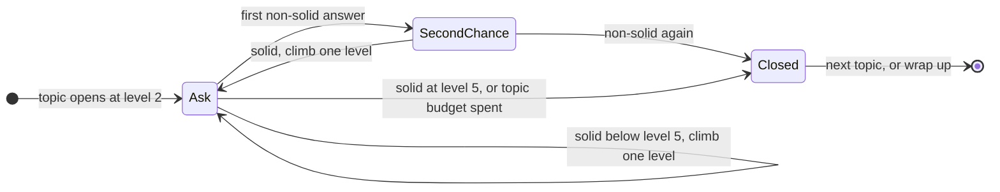
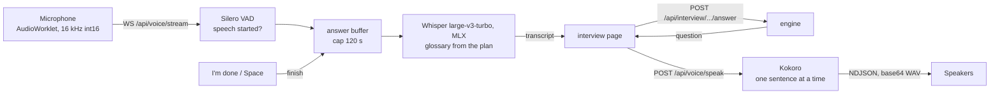
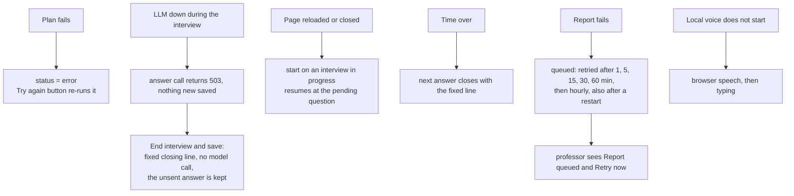

# Architecture

How Pythagoras is put together, and where each rule is enforced. The decisions behind it are in
[`DECISIONS.md`](DECISIONS.md) (referenced below as D1…D25), the page and API contract in [`API.md`](API.md).

## 1. Building blocks

The StudentClash brief gives a reference architecture for an agent: interface, orchestrator loop, LLM, system
prompt, guardrails, tools, memory, logs. This is where each block lives in the code.

| Block | In Pythagoras | Code |
|---|---|---|
| User interface | Team pages (upload, interview room) and professor pages (assignments, report). Static HTML/CSS/JS, no build step | `pythagoras/static/` |
| Orchestrator | Deterministic interview rules: which move comes next, per-topic time budgets, a hard time cap. At the end it hands over to the professor | `engine.py` |
| LLM | Three roles on one key: reasoner (plan, report), judge (one answer), talker (one spoken line) | `llm.py` |
| System prompts | One per role, versioned in git next to the code that calls them | `planner.py`, `supervisor.py`, `talker.py`, `report.py` |
| Guardrails | Checks in code that hold whatever the model says (section 5) | `engine.py`, `talker.py`, `report.py` |
| Tools / actions | Build the interview plan, judge an answer, send the invite email, record an integrity signal, write the report | `planner.py`, `supervisor.py`, `mailer.py`, `app.py`, `report.py` |
| Memory | Structured interview state, not chat history: level, misses and time per topic, every turn with its judgement | `models.py`, `db.py` |
| Logs and evaluation | Every turn stored with verdict and time; per-turn latency in the server log; offline tests; a spoken end-to-end run | `tests/`, `scripts/smoke.py` |
| Real material | The team's deliverable (PDF, code, notebooks), the course material and the learning objectives | `planner._blocks` |

There is no vector store: one project's files fit in the model's context, so the planner reads them whole (PDFs as
documents, with layout and figures; code with line numbers).

## 2. Three phases

The three objects on the arrows are Pydantic models in `models.py`. They are the contract between the phases and
are stored as JSON columns on the `submissions` row.

- **`InterviewPlan`**: 3 topics in priority order. Each has a neutral title, the claim the deliverable makes, an
  anchor (`page 3`, `mlp.py:25`), a time budget and one question per Bloom level 2 to 5 with the points a good
  answer must mention. Plus a critical analysis for the professor.
- **`InterviewState`**: per topic, the highest level answered solidly, the level being asked, the misses and the
  time spent; and the list of turns (move, question, answer, judgement).
- **`InterviewReport`**: summary, ownership (strong / mixed / weak), per-topic result with quotes, strengths,
  concerns, suggested oral-exam questions, and the quotes the code could not find in the transcript.

## 3. One turn

What keeps the reply short:

1. **The acknowledgement** is synthesized ahead of time and plays the moment the answer ends.
2. **The judge runs without extended thinking** (`fast=True`).
3. **The guess** (`engine._if_solid`): most answers are solid, and the move a solid answer leads to is known before
   the verdict. It is worked out on a deep copy of the state, phrased in a worker thread while the judge runs, and
   used only if the real move turns out equal. The real state is never touched by the guess.
4. **Sentence-by-sentence speech**: the talker must open with a bridge of at most 8 words; each sentence is
   synthesized on its own, so audio starts while the question is still being generated.

Measured on an M1 Pro (Claude Haiku via OpenRouter, and Gemini Flash Lite): the next question starts about 2 to 4 s
after the answer ends. `scripts/smoke.py` prints the time of every stage on your machine.

The server keeps nothing in memory between requests: `engine.Interview` is rebuilt from the stored state on each
call. The interview API only ever receives answer text, so the voice path can change without touching it.

## 4. Interview rules

Per topic, with the normal rules:

- The second chance depends on the verdict: a partial answer gets a probe, a weak one or "I don't know" a hint.
- The opening question (summarise the project) is not judged.
- A **probe** pushes on what is missing without revealing it. A **scaffold** gives a small hint pointing to the
  team's own deliverable, then asks a simpler version.
- Whatever the rules say, 30 s before the end the next move is the closing line (`engine._capped`).
- The level reached on a topic is the highest level answered solidly.

**Demo rules** (`PYTHAGORAS_DEMO_RULES`, on by default for now, D25) run before these: "I don't know" always gets one
retry one Bloom level lower, and a second one in a row moves on; on the weights / initialisation topic any real
first answer climbs to level 3 whatever the judge said. The second rule overrides the judge, so set the flag to `0`
for a real assessment.

## 5. What the code enforces

A prompt can be talked around; a check in code cannot. Each row is something the model is asked to do and the code
does not rely on.

| The model is asked to… | The code makes sure | Where |
|---|---|---|
| judge one answer | it never decides what happens next: verdict in, rules decide | `engine._after_answer` |
| say one bridge sentence and one question | anything longer is cut to the first sentence plus the question | `talker.trim` |
| keep the level reached in the report | the engine's levels overwrite the writer's | `report.build` |
| quote the team verbatim | each quote is searched in the transcript; a shortened quote piece by piece, in order, inside one answer. What is not found is listed for the professor | `report.unverified` |
| return a plan / verdict / report | the output is validated against a Pydantic schema, or the call fails | `llm.parse` |
| plan exactly 3 topics | extra topics are dropped, questions sorted by level | `planner.make_plan` |
| stay within the time | time over closes the interview with a fixed line and no model call | `engine.answer`, `engine.finish` |

Two limits are in the prompts and in the data model rather than in a check: topic titles are neutral and planned
questions never name a flaw (the title is on the team's screen), and the talker gives no praise, grade, correction
or hint of the expected answer. And one is structural: there is no grade field anywhere in `InterviewReport`.

## 6. Voice

- Everything runs on the machine (Apple Silicon, `voice` extra). No audio leaves it.
- **The answer ends only when the team presses "I'm done"** (D24). An earlier version ended it automatically:
  Silero VAD for silence, then Smart Turn v3 (a model that hears from the audio whether a sentence is finished)
  after 1.0 s of pause, with a 2.5 s safety net. That detector is still in `audio.TurnDetector` with its tests,
  but a long pause to think could still end an answer, and in an exam that is the wrong failure.
- Half-duplex: the microphone is closed while Pythagoras speaks, so there is no echo to cancel.
- Without the extra, the same page uses the browser's speech APIs; without those, typing.

## 7. When something fails

The interview is saved after every turn, so the worst case of any failure is one unsent answer.

## 8. Data and privacy

- SQLite at `data/pythagoras.db`; uploaded files under `data/`. Neither is ever committed.
- The webcam preview is on with a REC badge, but the badge is visual only: no video or audio is stored or sent
  (D19). Leaving the tab or switching the camera off is logged with its time as a review prompt for the professor,
  never as a verdict (D17).
- The team does not see the report; the professor does (D9).
- Only the synthetic case `cases/ffnn` is tracked. Real student work never goes to a free tier that may train on it.

## 9. Not built

Multi-model council for the report, webcam or audio recording and click-to-play evidence, practice mode, professor
accounts, hosted speech for machines without Apple Silicon, deployment. See "Open for later" in
[`DECISIONS.md`](DECISIONS.md).
